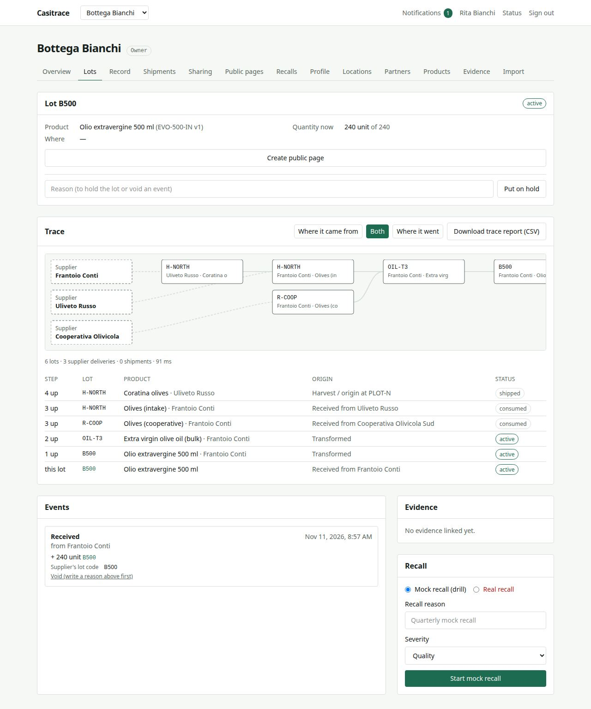
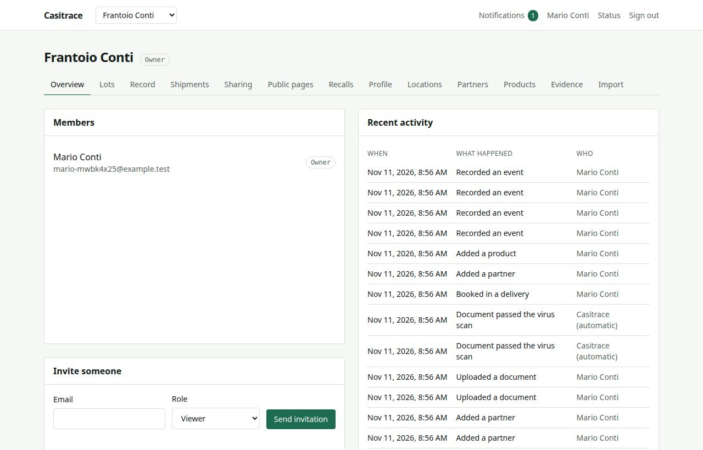
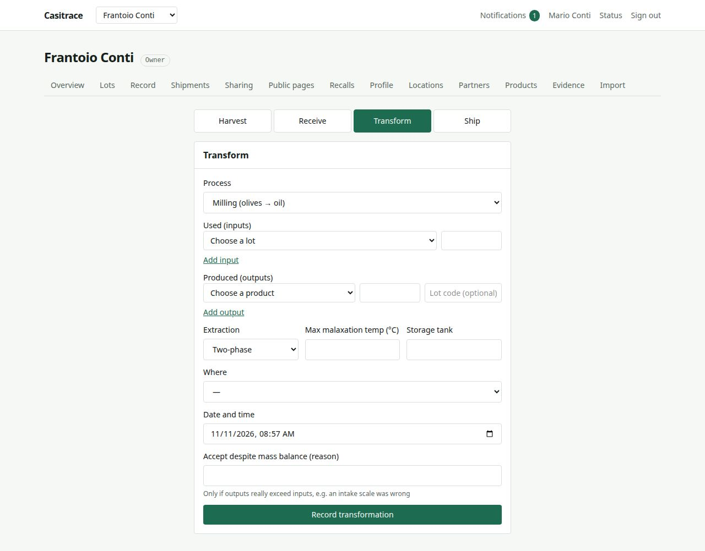
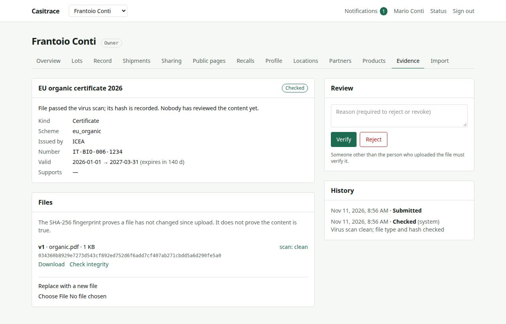
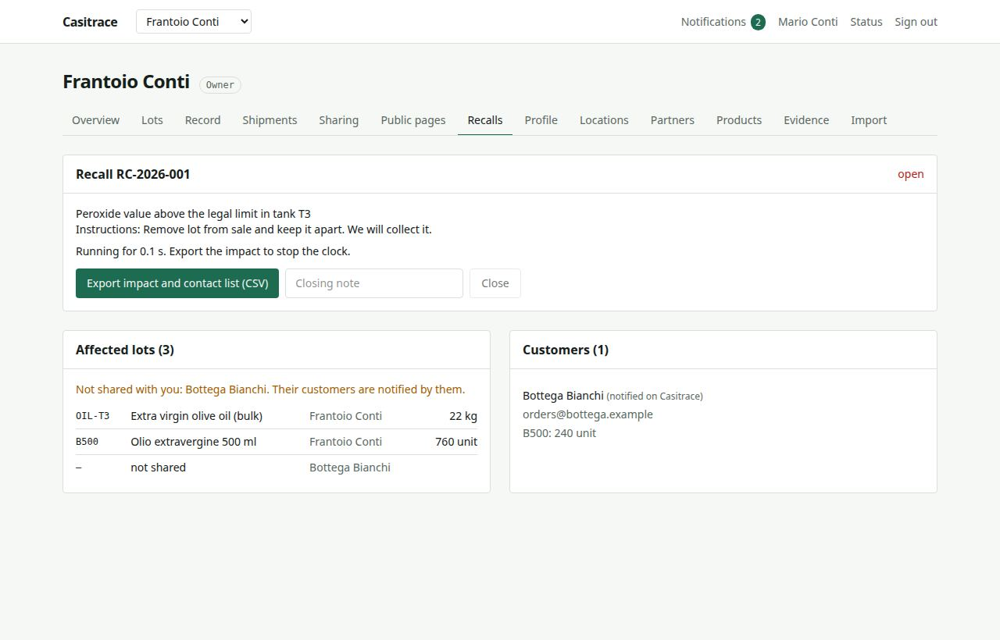
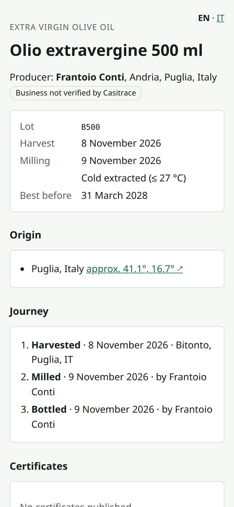

<div align="center">

# Casitrace

**Food traceability and evidence platform**

Trace any lot upstream to its suppliers and downstream to its customers, across company boundaries.
Back every claim with evidence and publish a signed public page for the product.


</div>



<sub>A shop traces its bottled oil lot <code>B500</code> back through the mill (Frantoio Conti) to two olive growers, across three organisations. Parts a partner has not shared appear as redacted supplier nodes.</sub>

---

## What it does

> Given any lot of a food product, a business can find, within minutes, every input lot and supplier upstream and every customer downstream, across company boundaries. It can show the evidence behind each claim and publish a verifiable public page for the product.

| Capability | What you get |
|---|---|
| **Lot traceability** | Record harvest, receive, transform and ship events. Lot genealogy, mass-balance checks (2 % tolerance) and corrections by voiding. Events are append-only. |
| **Cross-company exchange** | Shipments to partners on Casitrace become handoffs they accept. Sharing grants decide what each partner can see; everything else is redacted. |
| **Evidence** | Certificates and documents with virus scanning (ClamAV), SHA-256 integrity checks, expiry reminders and four-eyes verification. |
| **Public product passports** | Server-rendered pages (English and Italian) with a signed snapshot (Ed25519, KMS in production), GS1 Digital Link QR codes and a public directory. |
| **Recalls and drills** | Impact analysis across the chain, customer notices, lot blocking and a public recall banner. Drills measure time to export. |
| **Multi-tenant by design** | PostgreSQL row-level security per organisation, role templates, a full audit log and a test suite that attacks every API route across tenants. |

## Screenshots

<table>
  <tr>
    <td width="50%"><br><sub><b>Organisation overview</b>: members, invitations and a readable activity log.</sub></td>
    <td width="50%"><br><sub><b>Recording events</b>: milling with process data (KDEs) and mass-balance checks.</sub></td>
  </tr>
  <tr>
    <td width="50%"><br><sub><b>Evidence</b>: scanned file, fingerprint, history and verification by a second person.</sub></td>
    <td width="50%"><br><sub><b>Recalls</b>: affected lots across the chain and the customers to contact.</sub></td>
  </tr>
</table>

<p align="center">
  <br>
  <sub><b>Public passport</b>: what a consumer sees after scanning the QR code on the bottle.</sub>
</p>

## Architecture

One modular monolith, one worker and one web app, in a Bun workspace.

```
apps/
  api/        Hono HTTP API (OpenAPI), one module per bounded context
  worker/     Outbox relay and pg-boss jobs: email, virus scan, expiry, retention
  web/        React + Vite single-page app
packages/
  db/         Prisma schema, migrations and client factory
  contracts/  Zod schemas shared by API and web (permissions, KDE schemas, DTOs)
  shared/     AppError and ID helpers
  api-client/ Typed client generated from openapi.json
  observability/ OpenTelemetry tracing and Prometheus metrics
infrastructure/production/   Docker Compose deployment, Caddy, KMS, monitoring
```

API modules: `identity`, `access`, `parties`, `catalog`, `imports`, `evidence`, `traceability`, `exchange`, `publication`, `recalls`, `system`.

**Design principles**

- **Every change is audited.** All writes go through one command runner that commits the change, its audit entry and its outbox events in a single transaction.
- **History is never rewritten.** The audit log, trace events and lot genealogy are append-only and enforced by database triggers. Mistakes are corrected with new events.
- **Tenants are isolated in the database**, not only in application code, with row-level security on every tenant-owned table.
- **Public data is a deliberate choice.** Passport snapshots have a strict schema; tests scan every public response for private values.

**Stack:** Bun · TypeScript · Hono · Zod/OpenAPI · Prisma 7 · PostgreSQL · pg-boss · Better Auth · React 19 · Vite · SeaweedFS (S3) · ClamAV · OpenBao (KMS) · Caddy · OpenTelemetry · Prometheus.

## Getting started

### Requirements

- [Bun](https://bun.sh) 1.4.2
- Docker with Compose v2

### Run locally

```sh
cp .env.example .env
docker compose up -d --wait && docker compose up s3-init   # first start: ClamAV needs 1–2 min
bun install                                               # also generates the Prisma client
bun run db:setup                                          # migrations, runtime role, test database
bun run dev                                               # API + worker + web
```

| URL | What |
|---|---|
| http://localhost:5173 | Web app |
| http://localhost:5173/api/docs | API documentation (Swagger UI) |
| http://localhost:5173/api/ready | Readiness (database and storage) |
| http://localhost:8025 | Mailpit (captured email) |

### Common tasks

| Task | Command |
|---|---|
| Backend tests (real test database) | `bun run test` |
| End-to-end tests (Playwright) | `bun run e2e` (first run: `cd apps/web && bunx playwright install chromium`) |
| Lint / format | `bun run lint` / `bun run format` |
| Typecheck | `bun run typecheck` |
| New migration | `bun run db:migrate -- --name <name>`, then `bun run db:generate` and `bun run db:setup` |
| Regenerate the API client | `bun run openapi` (CI fails if it is stale) |
| Production rehearsal | `infrastructure/production/staging.sh up`, then `restore-drill.sh` and `load-test.sh` |

## Documentation

| Topic | Where |
|---|---|
| Roadmap and phase gates | [`roadmap-v2.md`](roadmap-v2.md) |
| Architecture decisions (16 ADRs) | [`docs/adr/`](docs/adr/) |
| Phase reports P0–P9 | [`docs/phases/`](docs/phases/) |
| Non-functional requirements | [`docs/architecture/`](docs/architecture/) |
| Security (threat model, ASVS checklist) | [`docs/security/`](docs/security/) |
| Compliance and data retention | [`docs/compliance/`](docs/compliance/) |
| Operations runbooks, restore drills, load tests | [`docs/operations/`](docs/operations/) |
| Audit 2026-11-11 | [`docs/audits/2026-11-11-full-audit.md`](docs/audits/2026-11-11-full-audit.md) |
| Domain glossary | [`docs/domain/glossary.md`](docs/domain/glossary.md) |
| Contributor and agent rules | [`CLAUDE.md`](CLAUDE.md) |

## Contributing

Work proceeds one roadmap phase at a time; a phase is done only when its exit gates pass. Before changing code, read [`CLAUDE.md`](CLAUDE.md): it lists the rules that are not negotiable (audited commands, append-only tables, tenant isolation, validated inputs, decimal quantities). A change to an architecture decision needs a new or amended ADR in the same change.
